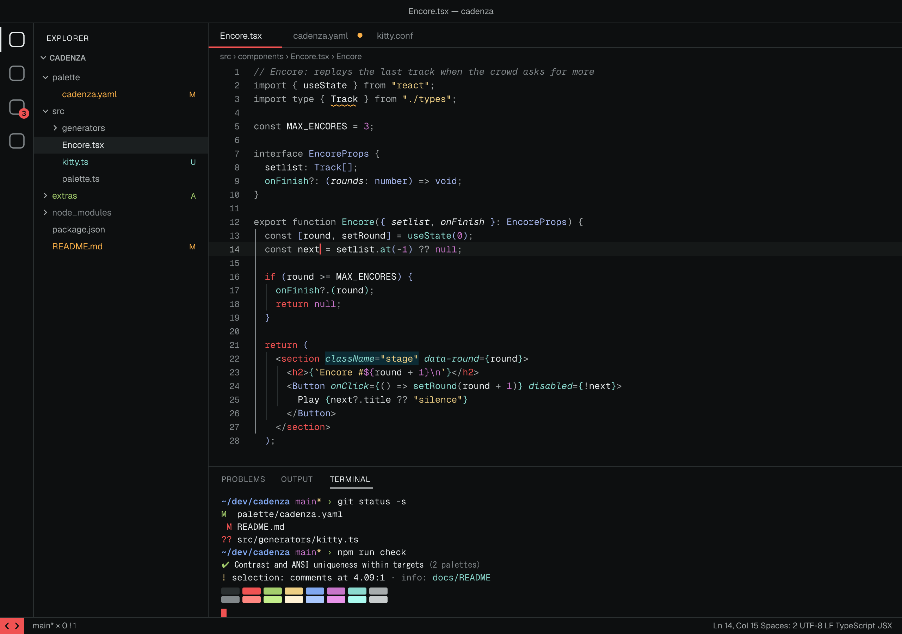
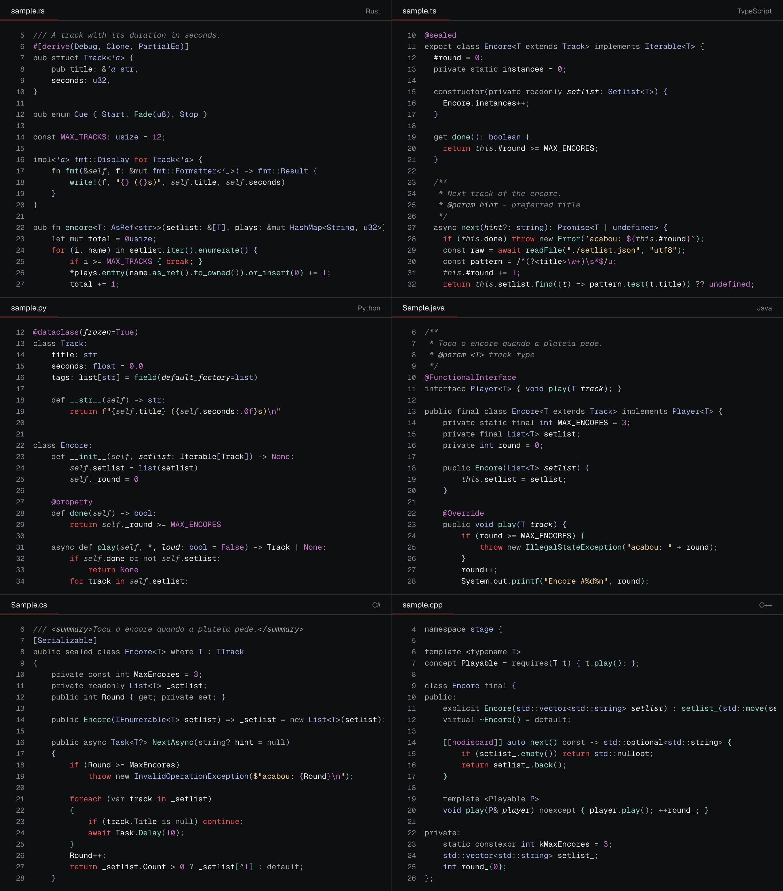

# Cadenza

A near-black theme for VS Code, kitty and Hyprland. The structure is flat and
restrained: one background, three greys for text, hairline borders instead of
grey panels, white primary buttons. The colour comes from a singer:
a scarlet jacket, a gold microphone, jade earrings and a lavender-shadowed
white dress.

In a classical concerto, the *fermata* is where the orchestra stops and the
soloist takes the *cadenza*. The icon is that fermata.

> Fan-made project, inspired by Astra Yao from Zenless Zone Zero.
> Not affiliated with, endorsed by, or associated with HoYoverse/Cognosphere.
> No official artwork is included in this extension or this repository.



## Install

Search for **Cadenza** in the Extensions view (`Ctrl+Shift+X`), or install from
[Open VSX](https://open-vsx.org/extension/muowl/cadenza-theme). Then pick it
with **Preferences: Color Theme** (`Ctrl+K Ctrl+T`).

## Two variants

**Cadenza** — the default. Scarlet marks control flow (`if`, `for`,
`match`, `return`, `throw`, `await`), tags, the cursor, the active tab and
badges. Everything else that is a reserved word — declarations (`const`, `fn`,
`def`, `class`, `=>`), modifiers (`pub`, `public`, `static`) and module
statements (`import`, `use`, `using`, `#include`) — stays in the punctuation
grey, so the name being declared is what you read first. `self` and `this` are
grey italic.

**Cadenza Chandelier** — the black-and-white outfit. The background drops a
step (close to `#0a0a0a`) and bronze replaces scarlet everywhere. The
only red left is for errors, so errors are the one thing that stands out.


## Languages

Checked against the grammars VS Code ships for Rust, TypeScript, Python, Java,
C#, C and C++, and against the semantic tokens their language servers send
(rust-analyzer, the TypeScript server, Pylance, the Java language server,
Roslyn, clangd and the Microsoft C/C++ extension). The same rules hold in every
language: red for control flow, grey for the rest of the keywords, orchid for
literals and metaprogramming (`@decorator`, `@Annotation`, `#[attribute]`,
`[[attribute]]`, C macros), lilac for types, jade for functions.

Where a language server can only tell control-flow keywords apart from the rest
(rust-analyzer, Roslyn), the theme follows its split. In C#, `int`, `string`,
`true` and `null` are plain keywords to Roslyn, so they are grey too.
rust-analyzer's underline for `mut` bindings is kept.



The screenshots show grammar-based highlighting only. With a language server
running, types, constants and macros get more precise (`Optional`, `MAX_ENCORES`
and enum members pick up their colours).

## Palette

<!-- palette:start — copied by hand from palette/cadenza.yaml; check_contrast compares the hex values -->

| token | hex | used for |
|---|---|---|
| `bg0` | `#0d0f10` | editor and all chrome (flat) |
| `bg1` | `#131517` | floating widgets, inputs |
| `bg3` | `#2a2f30` | borders |
| `selection` | `#0c2b34` | text selection (the hair's petrol blue) |
| `fg0` | `#e8eced` | primary text, variables |
| `fg1` | `#a7acad` | secondary text, punctuation, declarations |
| `muted` | `#81878a` | comments, line numbers |
| `scarlet` | `#f05252` | control-flow keywords, tags, accent |
| `gold` | `#eecf84` | strings |
| `jade` | `#8bdacf` | functions, attributes |
| `lilac` | `#a5b5eb` | types, components |
| `orchid` | `#c775c9` | numbers, constants, decorators |

<!-- palette:end -->

## What you get

- **Restrained colour.** Five syntax hues, one accent. Bracket pairs cycle
  three colours, and the outermost pair stays punctuation grey.
- **Checked contrast.** Every syntax colour clears 4.5:1 against the editor
  background; comments sit at 5.3:1 (floor 3:1). All syntax roles keep at
  least 3:1 on the selection background (comments: 4.1:1), and comments stay
  above 3:1 on find-match and merge highlights. The build fails if any checked
  pair drops below its floor.
- **Checked under simulated red-green colour blindness.** Syntax colours are
  separated by lightness as well as hue. The build simulates protanopia and
  deuteranopia (Machado 2009, full severity) and requires ΔE ≥ 6 in OKLAB
  between distinct syntax colours; the tightest pair is 7.9. This does not
  cover tritanopia or replace testing with people.
- **A real terminal palette.** 16 distinct ANSI colours. Bright variants are
  derived by raising OKLCH lightness by +0.10, with the same hue and chroma,
  so every accent brightens by the same perceptual step.
- **Full workbench coverage.** ~380 UI colours, including merge conflicts,
  IntelliSense icons and the debug console, so no stock blue leaks in.
- **Checked tokenization.** The build tokenizes sample files with VS Code's own
  engine and grammars (117 cases) and simulates the semantic-token chain for
  each language server above (37 cases). A colour that drifts fails the build.
- **Restrained italics.** Comments, parameters, `self`/`this` and HTML/JSX
  attributes only.

## Beyond VS Code

Every target is generated from the same palette file, in `extras/`:

| target | file | how to use |
|---|---|---|
| kitty | `extras/kitty/cadenza.conf` | copy to `~/.config/kitty/` and add `include cadenza.conf` |
| Hyprland | `extras/hyprland/cadenza.conf` | `source = ~/.config/hypr/cadenza.conf`, then use `$accent`, `$bg0`, `$border_active`… |
| Waybar | `extras/waybar/cadenza.css` | `@import "cadenza.css";` in `style.css`, then `@accent`, `@bg0`… |
| Base24 | `extras/base24/cadenza.yaml` | any [tinted-theming](https://github.com/tinted-theming) template (GNOME Terminal, Windows Terminal, tmux, rofi…) |
| JSON | `extras/json/cadenza.json` | palette, resolved roles and the 16 ANSI colours for anything else |

Colour names are identical across variants: switch to Chandelier by sourcing
`cadenza-chandelier.*` instead.

## Customizing

Want every keyword red? Override the grey keyword scopes in `settings.json`.
The list includes the scopes rust-analyzer and Roslyn fall back to, so it also
holds with a language server running:

```jsonc
"editor.tokenColorCustomizations": {
  "[Cadenza]": {
    "textMateRules": [
      {
        "scope": ["storage.type", "storage.modifier", "keyword.other", "keyword.cs",
                  "keyword.control.import", "keyword.control.export", "keyword.control.from"],
        "settings": { "foreground": "#f05252" }
      }
    ]
  }
}
```

## Building from source

```bash
npm install
npm run build     # checks contrast, colour-blindness and tokenization, then generates themes/, extras/ and assets/
npm run preview   # renders the README screenshots
npm run inspect -- sample.rs   # shows which palette colour each token gets
npm run package   # builds the .vsix
```

The palette lives in `palette/cadenza.yaml`; variants are overlays that only
declare what changes. Generators never contain hex values.

## License

MIT. Screenshots use [Geist Mono](https://vercel.com/font) (SIL Open Font License).
