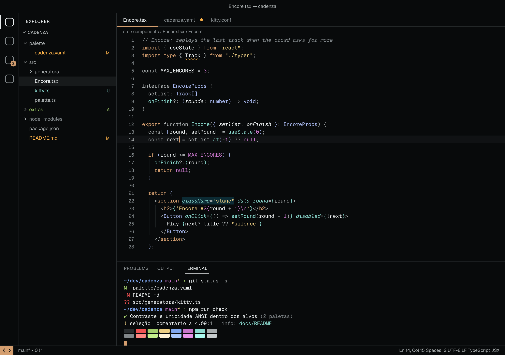

# Cadenza

A near-black theme for VS Code, kitty and Hyprland. The structure comes from
Vercel's Geist: one flat background, three greys for text, hairline borders
instead of grey panels, white primary buttons. The colour comes from a singer:
a scarlet jacket, a gold microphone, jade earrings and a lavender-shadowed
white dress.

In a classical concerto, the *fermata* is where the orchestra stops and the
soloist takes the *cadenza*. The icon is that fermata.

> Fan-made project, inspired by Astra Yao from Zenless Zone Zero.
> Not affiliated with, endorsed by, or associated with HoYoverse/Cognosphere.
> No official artwork is included in this extension or this repository.


## Install

Search for **Cadenza** in the Extensions view (`Ctrl+Shift+X`), or install from
[Open VSX](https://open-vsx.org/extension/muowl/cadenza-theme). Then pick it
with **Preferences: Color Theme** (`Ctrl+K Ctrl+T`).

## Two variants

**Cadenza** — the default. Scarlet marks control flow (`if`, `return`,
`import`, `export`), tags, the cursor, the active tab and badges. Declarations
(`const`, `function`, `class`, `=>`) stay in the punctuation grey, so the name
being declared is what you read first.

**Cadenza Chandelier** — the black-and-white outfit. The background drops a
step (close to Vercel's `#0a0a0a`) and bronze replaces scarlet everywhere. The
only red left is for errors, so errors are the one thing that stands out.



## Palette

<!-- palette:start — gerado à mão a partir de palette/cadenza.yaml; o check_contrast compara os hex -->

| token | hex | used for |
|---|---|---|
| `bg0` | `#0d0f10` | editor and all chrome (flat) |
| `bg1` | `#131517` | floating widgets, inputs |
| `bg3` | `#2a2f30` | borders |
| `selection` | `#0c2b34` | text selection (the hair's petrol blue) |
| `fg0` | `#e8eced` | primary text, variables |
| `fg1` | `#a7acad` | secondary text, punctuation, declarations |
| `muted` | `#81878a` | comments, line numbers |
| `scarlet` | `#f05252` | control-flow keywords, tags, accent |
| `gold` | `#eecf84` | strings |
| `jade` | `#8bdacf` | functions, attributes |
| `lilac` | `#a5b5eb` | types, components |
| `orchid` | `#c775c9` | numbers, constants, decorators |

<!-- palette:end -->

The scarlet sits at hue 24 in OKLCH. Geist's own red (`#e5484d`) sits at 23:
the jacket and the design system already agreed.

## What you get

- **Restrained colour.** Five syntax hues, one accent. Bracket pairs cycle
  three colours, and the outermost pair stays punctuation grey.
- **Checked contrast.** Every syntax colour clears 4.5:1 against the editor
  background; comments sit at 5.3:1 (floor 3:1). All syntax roles keep at
  least 3:1 on the selection background (comments: 4.1:1), and comments stay
  above 3:1 on find-match and merge highlights. The build fails if any checked
  pair drops below its floor.
- **Checked under simulated red-green colour blindness.** Syntax colours are
  separated by lightness as well as hue. The build simulates protanopia and
  deuteranopia (Machado 2009, full severity) and requires ΔE ≥ 6 in OKLAB
  between distinct syntax colours; the tightest pair is 7.9. This does not
  cover tritanopia or replace testing with people.
- **A real terminal palette.** 16 distinct ANSI colours. Bright variants are
  derived the way Vercel's terminal palette does it: +0.10 lightness in OKLCH,
  same hue and chroma.
- **Full workbench coverage.** ~380 UI colours, including merge conflicts,
  IntelliSense icons and the debug console, so no stock blue leaks in.
- **Restrained italics.** Comments, parameters and HTML/JSX attributes only.

## Beyond VS Code

Every target is generated from the same palette file, in `extras/`:

| target | file | how to use |
|---|---|---|
| kitty | `extras/kitty/cadenza.conf` | copy to `~/.config/kitty/` and add `include cadenza.conf` |
| Hyprland | `extras/hyprland/cadenza.conf` | `source = ~/.config/hypr/cadenza.conf`, then use `$accent`, `$bg0`, `$border_active`… |
| Waybar | `extras/waybar/cadenza.css` | `@import "cadenza.css";` in `style.css`, then `@accent`, `@bg0`… |
| Base24 | `extras/base24/cadenza.yaml` | any [tinted-theming](https://github.com/tinted-theming) template (GNOME Terminal, Windows Terminal, tmux, rofi…) |
| JSON | `extras/json/cadenza.json` | palette, resolved roles and the 16 ANSI colours for anything else |

Colour names are identical across variants: switch to Chandelier by sourcing
`cadenza-chandelier.*` instead.

## Customizing

Want every keyword red? Override the declaration colour in `settings.json`:

```jsonc
"editor.tokenColorCustomizations": {
  "[Cadenza]": {
    "textMateRules": [
      { "scope": ["storage.type", "storage.modifier"], "settings": { "foreground": "#f05252" } }
    ]
  }
}
```

## Building from source

```bash
npm install
npm run build     # checks contrast, colour-blindness and tokenization, then generates themes/, extras/ and assets/
npm run preview   # renders the README screenshots
npm run package   # builds the .vsix
```

The palette lives in `palette/cadenza.yaml`; variants are overlays that only
declare what changes. Generators never contain hex values.

## License

MIT. Screenshots use [Geist Mono](https://vercel.com/font) (SIL Open Font License).
